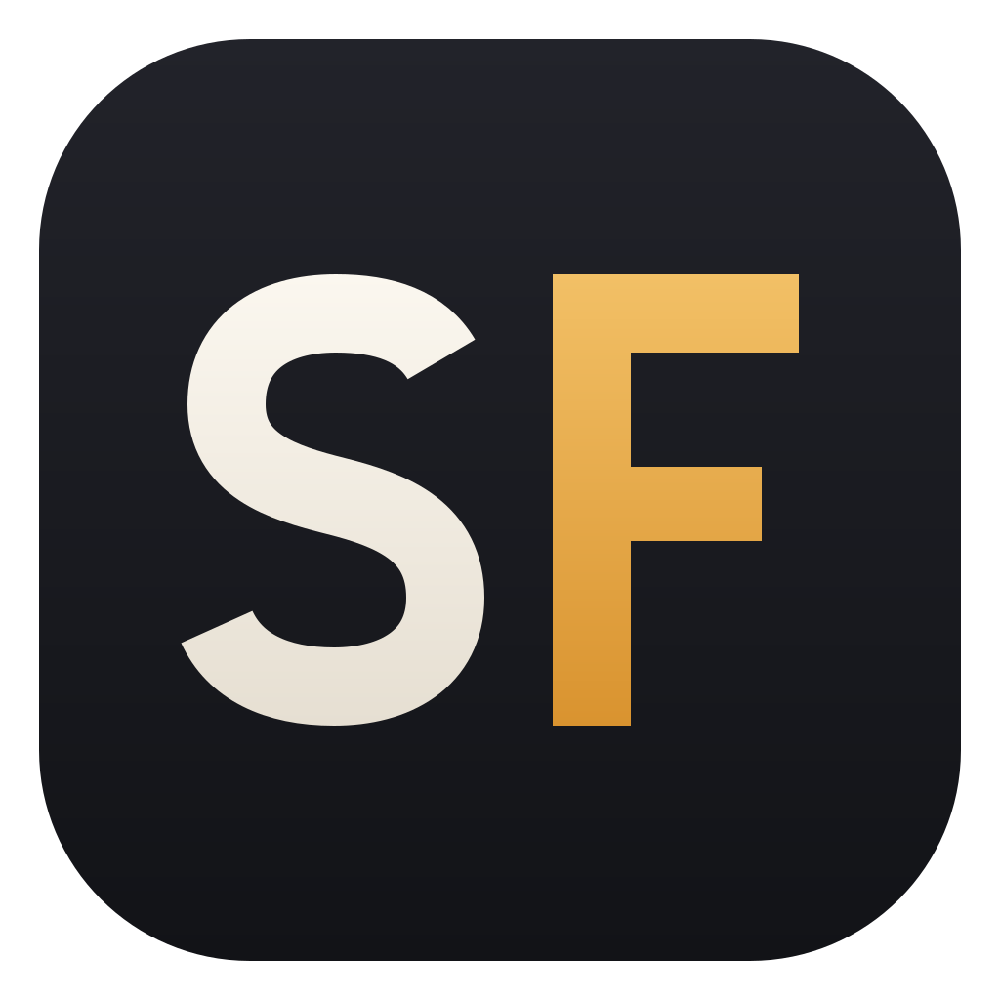
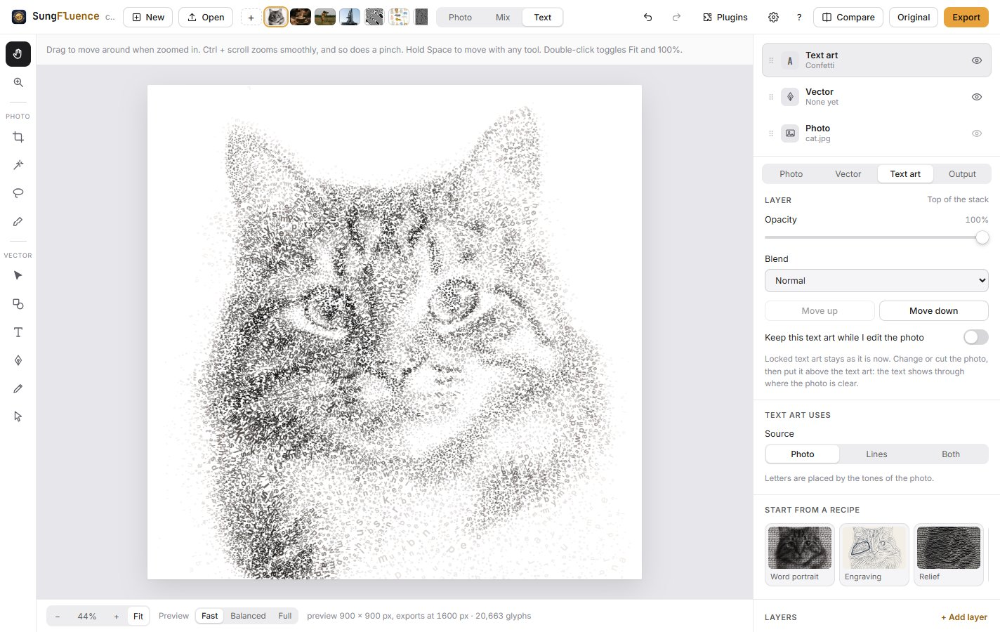

# SungFluence



A small design studio that turns pictures into art made only of letters and characters.

SungFluence is a free, open-source desktop app for Windows, macOS and Linux. It also runs in a browser and can be installed from there. Everything happens on your own computer. Photos are never uploaded.

**[Download the latest version](https://github.com/datakeen/Sungfluence/releases/latest)** · **[Try it in your browser](https://datakeen.github.io/Sungfluence/)** · [Help and tutorial](docs/help/index.md)

## How it started

SungFluence began as a weekend side project, something to do on a slow and boring weekend. I did not expect to like it this much. I kept coming back to it, one idea after another, until it grew into the app you see here.

## About the name

In Urdu, *sungam* (سنگم) is the point where two rivers meet and flow on as one. In English that meeting point is a *confluence*. SungFluence joins the two words, and the app does the same with pictures and letters: it lets them meet and become one piece of art.

The name is close to my heart. I love the science of water, and in my working hours I teach and research rivers and water. A name about two rivers meeting felt right.



## What it does

SungFluence works with three layers, like a small design app. You choose their order, opacity and blend mode, and the eye on each layer decides what you see.

- **Photo.** Crop on the canvas with corner and side handles (free or a fixed shape), rotate, flip, and change the canvas size. Adjust brightness, contrast, color, warmth, hue, shadows, highlights, sepia, vignette, grain, posterize, a black and white cut, pixelate, and bulge, pinch or twirl. Remove areas with a magic wand, lasso or brush. Text and shapes placed on the photo become part of it, so text art draws them too.
- **Vector.** Lines from the pen, pencil or tracing, which text can follow or which can be drawn as strokes. Shapes (rectangle, ellipse, polygon, star, line), text and images. Move, scale, rotate, align, flip, copy and paste. Step and repeat makes copies in a line, a grid, around a circle or along a line. Bulge or pinch the lines.
- **Text art.** Letters placed by the photo, written along the lines, or both. Stack several styles. Lock the text art to keep it while you change the photo, then put the photo on top and cut holes in it so the text shows through.

Start from a photo, or from a blank artboard: a square, social sizes, A4, Letter, posters, or any size in pixels, inches, millimeters or grid cells.

Views: Photo, Mix and Text are quick presets for the layer eyes. **Compare** shows a divider on the canvas with a different look on each side, for example the original photo on the left and the text art on the right, or the photo against the vector layer.

Zoom is smooth: the wheel and a trackpad pinch zoom in proportion to how far you move, and glide to the new size. A zoom tool zooms to a box you draw. Speed, glide time, steps, limits and wheel behavior are in **Settings**.

| Style | What it makes |
| --- | --- |
| Line text | Text along the center of drawn or traced lines. Letters follow the line width. |
| Text portrait | Your own text in rows, colored by the photo. |
| Word mosaic | Words packed into the picture, large in calm areas and small in detailed ones. |
| Flow lines | Text along the edges in the photo, like an engraving. |
| ASCII and Braille | Classic character art, measured and sorted by ink. |
| Halftone | A halftone screen made of letters. |
| Calligram | Text poured into a shape: the cutout, one or more lines of words, a heart, a circle or a star. Urdu and Arabic are set as joined words, right to left. |
| Spiral and Rings | One sentence on a spiral or on rings. It can start at the center or outside and run either way. Drag the center, start and end on the picture. |
| Relief | Rows of text lifted by the tones, like a terrain map. |
| Typewriter | Overstruck characters with ribbon ink and a small wobble. |
| Contours (extra effect) | Text along lines of equal tone, like a topographic map. |
| Confetti (extra effect) | Letters packed from large to small: large in calm areas, small in the details, turned along the picture. |

Every style can fade toward an oval, a circle, a band or a column. Drag the fade shape on the picture to move, size, soften or turn it. Letters can be see-through, italic, bolder or more widely spaced. Photo colors can be averaged under each letter and kept bright on dark paper, and a limited set of inks can be swapped for colors of your own.

Urdu and Arabic text uses the bundled Noto Nastaliq Urdu and Noto Naskh Arabic fonts, set word by word so the letters stay joined.

## Export


One **Export window** (Ctrl E) lists every format, with its options, the layers to include and the size of the result.

- **Pictures:** PNG, JPG or SVG of the layers you choose, photo and vector as PNG, the vector layer as SVG or PNG, and the edited photo layer.
- **Text art:** PNG for print or screen, SVG with live text, PDF, vector CMYK PDF and CMYK plates.
- **Print:** 31 paper, photo, poster and clothing sizes or your own, portrait or landscape, the art at any angle, a page margin and any dpi. The Printing help page explains which dpi to use.
- **Text twins:** any style as plain text, Markdown, an HTML page, terminal colors (16, 256 or full color) or an SVG for README files, at the width and with the characters you choose.
- **Code:** the art as a string or a comment in 16 programming languages, a `--help` header, or a login message.
- **Project files** (`.sungfluence`) that keep the photo, crop, removed areas, liquify, lines, objects, layers and settings. PNG and SVG files can also carry the style settings, so opening them brings the look back.

## Working in SungFluence

- **Menus for everything:** File, Edit, Image, Layer, Text art, Effects, Export, View and Help, with the shortcut next to each item.
- **Find any command** with Ctrl K: type a few letters of a command, a style, a recipe or a tool.
- **Snapping** while you draw and edit vectors: to ends, corners, middles, centers, crossings, extensions, perpendicular and tangent points, text baselines, edges in the photo, 15° angles and a grid. Hold Alt to place a point freely.
- **Help inside the app:** press F1 for a getting started tutorial and a reference for every panel and style. It works offline.
- **Plugins** add extra effects: the **Plugins** button at the top, or the **Effects** menu. See [docs/PLUGINS.md](docs/PLUGINS.md) to write your own.
- **Liquify** the photo with a brush: push, bloat, pucker, twirl and restore.
- **Compare** two looks with a divider that runs up and down, across or at any angle, also on the Paper and T-shirt previews.
- **Smooth motion:** quiet transitions, and letters that fly in when text art appears. Settings can calm it or turn it off.
- **Word and phrase library**, undo and redo, autosave, and a light and dark theme.
- **Never freezes:** heavy work runs in small steps with a progress bar and a Cancel button, so slow computers stay responsive.

## Download and install

Get the installers from the **[latest release](https://github.com/datakeen/Sungfluence/releases/latest)**. Or skip installing and **[use it in your browser](https://datakeen.github.io/Sungfluence/)**; in Chrome or Edge you can then choose **Install** in the address bar to keep it as an app.

| System | File | How to install |
| --- | --- | --- |
| Windows 10 and 11 | `SungFluence-Setup-x.y.z-x64.exe` | Run it and follow the steps. |
| Windows, no install | `SungFluence-Portable-x.y.z.exe` | Run it from any folder or USB stick. |
| macOS 11 or newer | `SungFluence-x.y.z-mac-universal.dmg` | Open it and drag SungFluence to Applications. |
| Linux, any distro | `SungFluence-x.y.z-linux-x86_64.AppImage` | Make it executable, then run it. |
| Ubuntu and Debian | `SungFluence-x.y.z-linux-amd64.deb` | `sudo apt install ./SungFluence-x.y.z-linux-amd64.deb` |

Not sure which file you need? See [the download guide](docs/downloads/README.md).

The builds are not code-signed yet, so each system warns the first time:

- **Windows:** "Windows protected your PC". Click **More info**, then **Run anyway**.
- **macOS:** right-click the app in Applications, choose **Open**, then **Open** again. If macOS says the app is damaged, run `xattr -cr /Applications/SungFluence.app` in Terminal.
- **Linux AppImage:** run `chmod +x SungFluence-*.AppImage` first.

## Run from source

You need [Node.js](https://nodejs.org) 20 or newer and [Git](https://git-scm.com).

```bash
git clone https://github.com/datakeen/Sungfluence.git
cd Sungfluence
npm install
npm start          # builds src/ from app/ and opens the desktop app
npm run web        # serves the web version at http://localhost:8080
```

You can also double-click `src/index.html` to use the app in a browser.

Edit the files in `app/`, never in `src/`. Then run `npm run build` (or `npm start`), which writes `src/`.

## Tests

```bash
npx playwright install chromium   # once
npm test                          # regression, plugin, studio, effects, and command and snapping tests
npm run test:smoke                # opens src/index.html from disk, like a double-click
```

The tests use the two images in `tests/images`; the effects test also uses the sample cat. If Playwright's own Chromium cannot start on your computer, the tests use the Chrome or Edge you already have. Screenshots go to `tests/out/`.

## Build installers

Details, GitHub Actions and troubleshooting are in **[docs/BUILDING.md](docs/BUILDING.md)**. In short:

```bash
npm run dist:win     # on Windows: setup .exe and portable .exe
npm run dist:mac     # on a Mac: .dmg
npm run dist:linux   # on Linux: .AppImage, .deb and .tar.gz
```

Files appear in `dist/`. Each system builds its own installers best, so the GitHub workflow builds all three for you: push a tag such as `v3.2.0` and a draft release with every installer appears after about 15 minutes.

## Signing (optional)

Unsigned apps work, but signed apps install without warnings.

- **Windows:** buy a code-signing certificate. Add it as repository secrets `CSC_LINK` (the base64 .pfx) and `CSC_KEY_PASSWORD`.
- **macOS:** join the Apple Developer Program (99 USD a year). Add the secrets `CSC_LINK`, `CSC_KEY_PASSWORD`, `APPLE_ID`, `APPLE_APP_SPECIFIC_PASSWORD` and `APPLE_TEAM_ID`. Then turn on notarization in the `mac` section of `package.json`.

Then remove `CSC_IDENTITY_AUTO_DISCOVERY: false` from `.github/workflows/release.yml`. The [electron-builder signing guide](https://www.electron.build/code-signing) has the details.

## Project layout

```
app/                      the source: edit these
  body.html               the page markup
  styles.css              interface styles, light and dark
  icon.svg                the app icon (run npm run icons after changing it)
  engine.js               image to text engine: styles, tracing, color models, SVG and text export, plugin registry
  parts/                  the interface, in load order: data, core, reveal, tools, objects, studio, snapping, liquify, panels, plugins, help, commands, export, io
  plugins/                built-in plugins; sungfluence-plugin-template.js is the starter for plugin authors
  samples/                sample images; "01-cat.jpg" becomes the sample "cat"
scripts/build.js          builds src/ (and single/sungfluence.html with --single), including the help pages
scripts/docs.js           writes the style reference and the shortcut list from the code
scripts/help-shots.js     takes the tutorial screenshots
scripts/icons.js          draws build/icon.png and src/icons/*.png from app/icon.svg
src/                      generated app: desktop, web and double-click
main.js                   desktop window and its menu bar (Electron)
preload.js                the small bridge that gives the desktop app its menus
tests/                    browser tests with Playwright, and tests/images
docs/                     help pages (docs/help), the plugin guide, the build guide, the release checklist, wiki pages
.github/workflows/        installer builds and the web deploy
```

## How the engine works

1. **Load:** the photo, its distortion and the objects placed on it are cropped and scaled. Previews use a smaller copy; exports use a full-size one.
2. **Treat:** the photo is adjusted and filtered, and removed areas are masked out.
3. **Prepare tones:** each text layer turns the tones into an ink map with contrast, gamma and auto levels, then applies its fade.
4. **Place glyphs:** the style turns the ink map, or the lines, into a list of glyphs and rectangles.
5. **Output:** the same list is drawn to the screen and written to SVG, PDF and text, so every export matches the preview.
6. **Compose:** the three layers are stacked in your order with their opacity and blend mode.

## Help

Press **F1** in the app, or click **?** and then **Help and tutorial**. The same pages are in [docs/help](docs/help/index.md); start with [Getting started](docs/help/getting-started.md).

## What is new, and what is next

Every release is listed in [CHANGELOG.md](CHANGELOG.md). The plan toward a full design studio is in [ROADMAP.md](ROADMAP.md): full support for right-to-left languages such as Urdu and Arabic, and for top-to-bottom languages such as Chinese; print and maker exports; animation; batch work; and optional AI.

## Feedback and contributing

Found a bug, or have an idea? Please [open an issue](https://github.com/datakeen/Sungfluence/issues) on GitHub. Click **New issue**, give it a short title, and describe what happened or what you would like. Screenshots help.

Bug reports, new styles, plugins and translations are welcome. See [CONTRIBUTING.md](CONTRIBUTING.md), and [docs/PLUGINS.md](docs/PLUGINS.md) for writing a plugin.

## Made by

SungFluence is made by Ahmed Bilal. You can find me on [LinkedIn](https://www.linkedin.com/in/abilal/).

## License

SungFluence is free and open source software. You may use it, share it and change it, for free, for any purpose.

It is released under the [GNU Affero General Public License](LICENSE), version 3 or any later version. If you share a changed version, or run one as a website or online service, you must share its source code under the same license.

Copyright (C) 2026 Ahmed Bilal and contributors.

The formal notice: SungFluence is free software: you can redistribute it and/or modify it under the terms of the GNU Affero General Public License as published by the Free Software Foundation, either version 3 of the License, or (at your option) any later version.

SungFluence is distributed in the hope that it will be useful, but WITHOUT ANY WARRANTY; without even the implied warranty of MERCHANTABILITY or FITNESS FOR A PARTICULAR PURPOSE. See the GNU Affero General Public License for more details.

You should have received a copy of the GNU Affero General Public License along with this program, in the file [LICENSE](LICENSE). If not, see <https://www.gnu.org/licenses/>.

If you run a changed version of SungFluence on a server where other people use it, the AGPL asks you to offer those people the source code of your version. To find the source code from inside the app, click **?** at the top right, then **About and license** at the bottom of that panel, then **Source code**. In the desktop app, **Help → Project page and source code** opens it too.

## Credits

- **Fonts:** Inter, JetBrains Mono, Playfair Display, Oswald, Noto Naskh Arabic and Noto Nastaliq Urdu use the SIL Open Font License 1.1. Special Elite uses the Apache License 2.0. The font files come from [Fontsource](https://fontsource.org).
- **Libraries:** [jsPDF](https://github.com/parallax/jsPDF) (MIT) and [JSZip](https://github.com/Stuk/jszip) (MIT). [Electron](https://www.electronjs.org) and [electron-builder](https://www.electron.build) (MIT). Tests use [Playwright](https://playwright.dev) (Apache 2.0).
- **Plugin template** and the built-in Contours and Confetti plugins are MIT licensed, so plugin authors can choose their own license.
- **Sample pictures** cat, coffee, camera, rocket, animals, swirl and face were made with AI image tools by the author for this project.
- **Sample "lines"** and the test images in `tests/images` were generated for this project.
