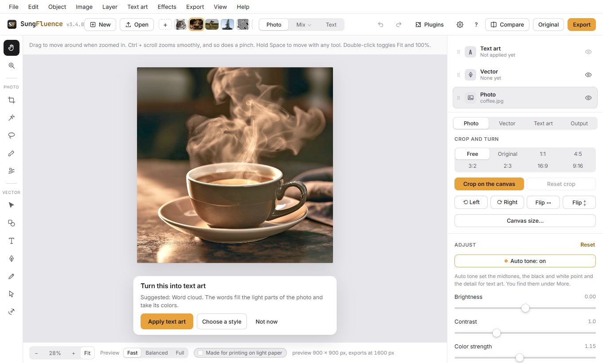
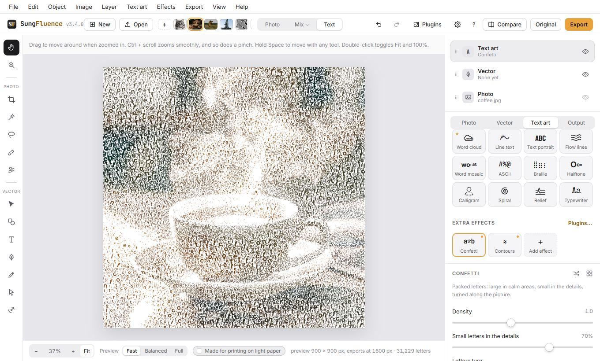
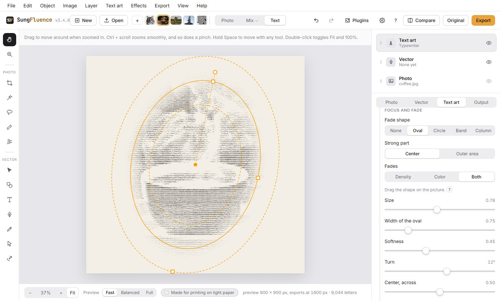
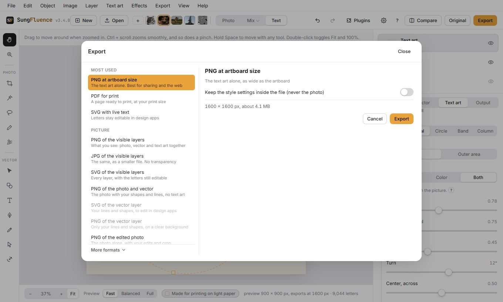

# Getting started

Five short steps: from a photo to a finished piece of text art. Take about five minutes.

## 1. Open a picture

SungFluence opens with a sample photo of a cup of coffee. To use your own picture, click **Open** at the top left and pick a photo, or drag a photo onto the window. The small pictures next to Open are more samples; click one to try it.

A card under the picture offers to **turn this into text art**. Click **Apply text art** to see a first look right away. The photo stays on screen while the letters are set, then the letters land on it. The first look is a **Word cloud**, the signature style of SungFluence: words such as love, family, home and care, packed inside the shape of your photo, in the photo's own colors, on warm black paper. On a lit subject on a darker ground, such as the coffee cup or a face, the light parts hold the words. On a plain dark subject on a light ground, such as a loaf of bread on a white table, the dark parts do. SungFluence reads the shape, the threshold and the colors from your photo, and the words start at the usual size; **Text size** makes them bigger or smaller.

Some photos give no clear shape for a Word cloud: a line drawing, a soft picture such as a sunset, several subjects spread over the picture, or a dark subject that runs into its background. A dark subject full of detail, such as the drawn cat or the launch tower, has a clear outline, but on dark paper a Word cloud would keep only that outline and lose the eyes or the struts. Such a photo starts in the style that suits it best, and the card says so, for example "This photo has no clear shape for a Word cloud, so it starts as Halftone. Word cloud is one click away." After you apply it, a short note with a **Word cloud** button says the same for a few seconds. A **Halftone** is a screen of letters in the photo's own colors; a line drawing becomes a **Text portrait** whose letters fill its strokes. Click the **Word cloud** tile, or the **Word cloud** recipe, to get the signature look anyway. These other first looks start on white paper. The note under the picture says what the art is made for, and a click on it lets you change the paper. You can change everything afterwards. After you apply it, the Text art panel opens on the settings of that style.

## 2. Choose a style

On the right, the **Text art** panel opens with the style tiles at the top, under **Look**. Click a tile: Word cloud, the first tile and the signature style, then Text portrait, Word mosaic, ASCII, Calligram, Spiral and more. Below the main styles, **Extra effects** has Confetti and Contours.

Not sure where to start? Click the **Recipes** tab beside **Styles** and click any picture. A recipe sets the style, the paper and the colors in one go.

## 3. Make it yours

Under the tiles come the style's own settings, then **Words**, **Size**, **Color** and **Background**. The most useful ones:

- **Text**: type your own words. Click **Library** for ready-made words and phrases.
- **Letter size** or **Columns**: how fine the result is. **Scale all letters** makes every letter bigger or smaller at once, on top of the style's own sizes.
- **Color**: Ink (one color), Photo (the photo's own colors), Tone, or Duotone (two inks).
- **Typeface**: the font. Urdu text uses Nastaliq on its own.

- **Background**: the paper color, or **Transparent**.

Below them are sections you can open: **Mirror**, **Shape** (draw on part of the picture, fade the letters toward a shape you drag on the picture, turn the text), **Finish** (letter fill, effects and opacity) and **Tone**. A small **?** at the end of a note tells you more.

Click **Variations**, the four squares beside the style's name, to see several takes at once, and click the one you like. **Every style**, beside the tiles, or the **Shift E** key, shows your picture in every style on one wall, so you can see them all before you choose.

## 4. Look at it properly

- The **Photo**, **Mix** and **Text** buttons at the top show the photo, the text art over a faded photo, or the text art alone.
- Hold **Original** to see the photo for a moment. **Compare** puts a divider on the picture with a different look on each side.
- Zoom with Ctrl and the mouse wheel, or a pinch on a trackpad. Double-click the picture to switch between Fit and 100%.
- The preview is drawn smaller so it stays fast. Choose **Full** at the bottom when you want to check fine detail.

## 5. Export

Click **Export** at the top right. The Export window opens: pick a format on the left, check its options on the right, and click **Export**.

- **PNG for print** or **PDF for print**: a page size such as A3 at 300 dpi. Choose the size in the **Output** panel.
- **SVG with live text**: letters you can still edit in Illustrator, Inkscape or Figma.
- **Plain text**, **Terminal colors** and **Code**: the art as characters to paste into chats, terminals and programs.
- **Save project** (Ctrl S): keeps everything in one `.sungfluence` file, so you can open it later and carry on.

That is it. Next, try a calligram with your own word, or read about [the window](workspace.md) and the [text art styles](styles.md).
