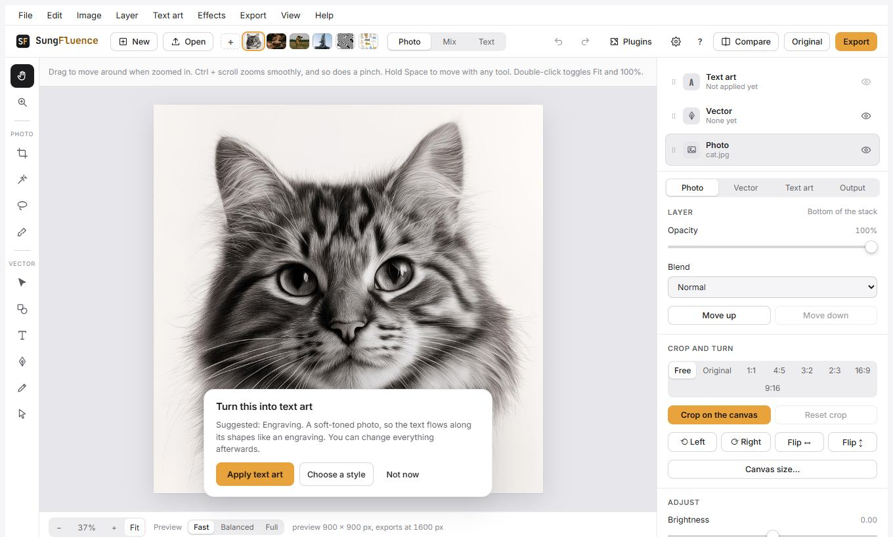
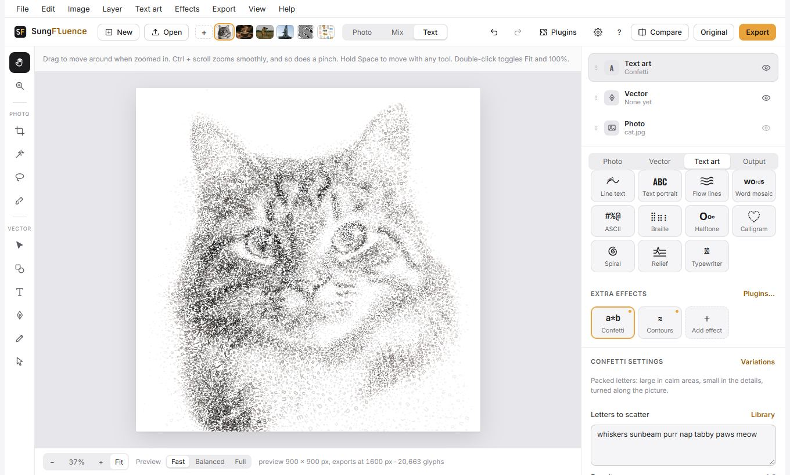
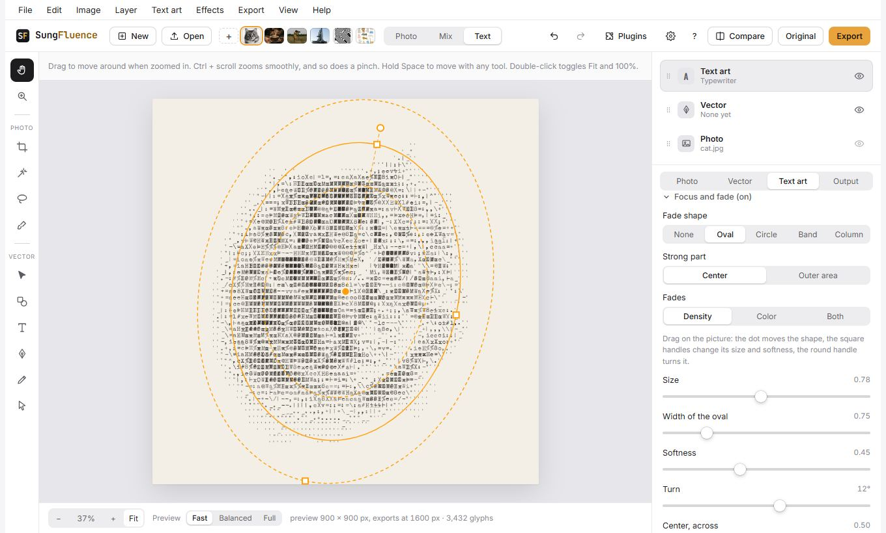
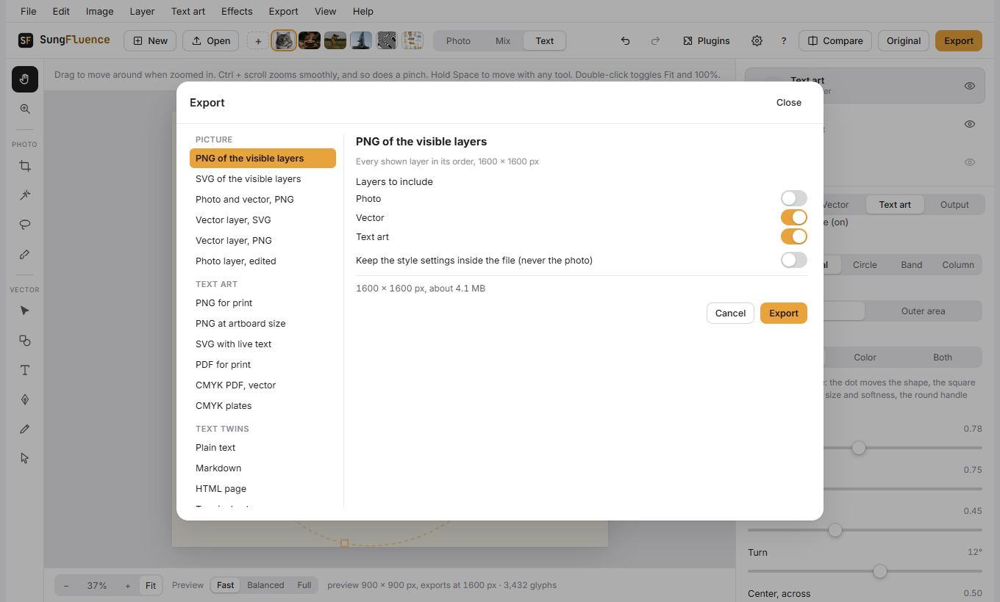

# Getting started

Five short steps: from a photo to a finished piece of text art. Take about five minutes.

## 1. Open a picture

SungFluence opens with a sample cat. To use your own picture, click **Open** at the top left and pick a photo, or drag a photo onto the window. The small pictures next to Open are more samples; click one to try it.

A card in the corner offers to **turn this into art**. Click **Apply text art** to see a first look right away.

## 2. Choose a style

On the right, the **Text art** panel opens. Scroll to **Style** and click a tile: Text portrait, Word mosaic, ASCII, Calligram, Spiral and more. Below the main styles, **Extra effects** has Confetti and Contours.

Not sure where to start? Scroll up to **Start from a recipe** and click any card. A recipe sets the style, the paper and the colors in one go.

## 3. Make it yours

Each style has its own settings under its tiles. The most useful ones:

- **Text**: type your own words. Click **Library** for ready-made words and phrases.
- **Letter size** or **Columns**: how fine the result is.
- **Color**: Ink (one color), Photo (the photo's own colors), Tone, or Duotone (two inks).
- **Typeface**: the font. Urdu text uses Nastaliq on its own.

Below them are sections you can open: **Letters** (weight, spacing, italic), **Focus and fade** (fade the letters toward a shape you drag on the picture), **Opacity, effects and inks**, and **More controls**.

Click **Variations** next to the style name to see several takes at once, and click the one you like.

## 4. Look at it properly

- The **Photo**, **Mix** and **Text** buttons at the top show the photo, the text art over a faded photo, or the text art alone.
- Hold **Original** to see the photo for a moment. **Compare** puts a divider on the picture with a different look on each side.
- Zoom with Ctrl and the mouse wheel, or a pinch on a trackpad. Double-click the picture to switch between Fit and 100%.
- The preview is drawn smaller so it stays fast. Choose **Full** at the bottom when you want to check fine detail.

## 5. Export

Click **Export** at the top right. The Export window opens: pick a format on the left, check its options on the right, and click **Export**.

- **PNG for print** or **PDF for print**: a page size such as A3 at 300 dpi. Choose the size in the **Output** panel.
- **SVG with live text**: letters you can still edit in Illustrator, Inkscape or Figma.
- **Plain text**, **Terminal colors** and **Code**: the art as characters to paste into chats, terminals and programs.
- **Save project** (Ctrl S): keeps everything in one `.sungfluence` file, so you can open it later and carry on.

That is it. Next, try a calligram with your own word, or read about [the window](workspace.md) and the [text art styles](styles.md).
